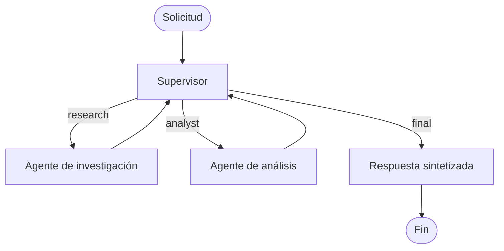

# Pre-entrega 6 — Orquestador multi-agente especializado

Prototipo funcional en Python/LangGraph para analizar una consulta mediante una topología jerárquica: un **Supervisor** decide dinámicamente si debe intervenir Investigación, Análisis o finalizar. El único proveedor de LLM es **Groq**.



También puede generarse un PNG del grafo desde el propio LangGraph:

```powershell
python export_graph.py
```

El archivo se crea en `artifacts/orchestrator-graph.png`. El diagrama Mermaid anterior se mantiene en el README para que pueda verse directamente en GitHub o VS Code.

## Qué incluye

- Estado estructurado `OrchestratorState`, que hereda de `MessagesState` y conserva mensajes, aportes, historial de routing, iteraciones y trazabilidad.
- Agente **research** con búsqueda web real mediante DuckDuckGo (`ddgs`), con resultados y URLs citables.
- Agente **analyst** con herramientas delimitadas: cálculo matemático seguro y análisis de sentimiento heurístico.
- Supervisor con salida estructurada, validación de rutas y límite de iteraciones para prevenir ciclos.
- Síntesis final con Groq, y fallback legible si el proveedor no está disponible.
- Persistencia opcional en memoria usando `MemorySaver` y `thread_id`.
- Pruebas automatizadas que no consumen API.

## Requisitos

- Windows 10/11
- Python 3.11 o superior
- Una clave de [Groq](https://console.groq.com/keys) (es gratuita para pruebas)

## Instalación en VS Code (Windows)

Abra la carpeta `IA-Entrega-6` con **File → Open Folder**. En la terminal integrada de PowerShell ejecute:

```powershell
py -3.11 -m venv .venv
.\.venv\Scripts\Activate.ps1
pip install -r requirements.txt
Copy-Item .env.example .env
```

Edite `.env` y pegue la clave:

```env
GROQ_API_KEY=gsk_tu_clave_aqui
```

En VS Code seleccione el intérprete `.venv` cuando aparezca la sugerencia. No suba `.env` al repositorio.

## Ejecutar la demo

```powershell
python demo.py "Investigá el impacto de la IA generativa en educación y calculá la variación porcentual entre 120 y 156."
```

El flujo imprime la respuesta, las fuentes consultadas y el historial de decisiones. Para reutilizar el estado durante la misma ejecución:

```powershell
python demo.py "Analizá el sentimiento de: Me encanta este avance, aunque me preocupa su costo" --thread-id clase-6
```

El checkpointer es en memoria: persiste entre invocaciones al grafo dentro del proceso, no entre reinicios. Para persistencia durable puede reemplazarse por un checkpointer SQLite/Postgres de LangGraph.

## Pruebas

```powershell
pytest -q
```

## Estructura

```text
src/orchestrator/
  state.py       # Contrato de estado compartido
  tools.py       # Herramientas acotadas y funcionales
  agents.py      # Research, analyst, supervisor y síntesis
  graph.py       # Grafo jerárquico y persistencia opcional
demo.py          # Ejemplo ejecutable
tests/           # Tests sin red ni API
```

## Decisiones de diseño

El Supervisor recibe la conversación y el estado de contribuciones; devuelve estrictamente `research`, `analyst` o `final`. Antes de esa decisión se aplican guardas: no se supera `MAX_ITERATIONS`, no se repite un especialista que ya aportó y el agente de análisis se ejecuta después de investigación cuando ésta era necesaria. Esto evita pérdida de contexto y loops del enrutamiento asíncrono.

Elegí una topología **jerárquica con Supervisor central** porque los especialistas no se coordinan entre sí ni toman la decisión final: cada uno tiene un alcance pequeño y devuelve evidencia al estado compartido. Así, una solicitud mixta puede pasar de `research` a `analyst` sin perder las fuentes, y la síntesis sólo ocurre cuando el Supervisor lo autoriza.

Los posibles conflictos se resuelven en el Supervisor y no por "votación" entre agentes. Sus reglas deterministas tienen prioridad sobre la sugerencia del LLM: impiden repetir una contribución existente, ordenan investigación antes de análisis cuando se necesitan ambas, registran cada decisión en `routing_history` y finalizan al alcanzar el límite de iteraciones. Si una búsqueda falla, el resultado conserva ese error como evidencia y la síntesis lo comunica en lugar de inventar información.

`GROQ_MODEL` permite cambiar el modelo, por defecto `openai/gpt-oss-120b`. Las llamadas de búsqueda no usan ningún LLM; Groq sigue siendo exclusivamente el proveedor LLM del proyecto.
